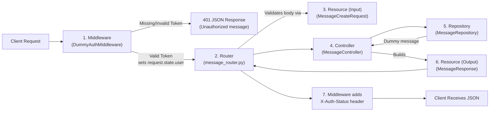

# FastAPI Backend Layers & Request Flow

This project demonstrates a simple, clean **layered backend architecture** in FastAPI without a database. Instead of real DB queries and JWT verification, it uses dummy messages and a dummy token (`Bearer dummy-token`) so you can focus purely on how the layers fit together.

---

## 1. Project Structure

```text
clean-architecture/
├── main.py                              # App entrypoint: wires middleware & routers
├── requirements.txt
├── ARCHITECTURE_FLOW.md                 # This guide
└── src/
    ├── middleware/
    │   └── auth_middleware.py           # Intercepts requests for dummy auth
    ├── resources/
    │   └── message_resource.py          # Pydantic request/response contracts (DTOs)
    ├── repositories/
    │   └── message_repository.py        # Data layer (dummy messages instead of DB)
    ├── controllers/
    │   └── message_controller.py        # Business logic connecting router & repository
    └── routers/
        └── message_router.py            # HTTP routes & dependency injection
```

---

## 2. How a Developer Builds This (Step-by-Step)

When building a new feature, developers typically work **inside-out** or **contract-first** so each layer has a clear boundary:

1. **Step 1 — Resource (`src/resources/message_resource.py`)**
   Define the **shape of data** entering and leaving your API (`MessageCreateRequest`, `MessageResponse`).
   - *Why first?* Everything else depends on knowing what input you accept and what JSON response you promise to return.
2. **Step 2 — Repository (`src/repositories/message_repository.py`)**
   Define how data is fetched or saved (`get_welcome_message`, `save_message`).
   - *Why here?* Today it returns dummy strings; tomorrow you can swap in SQLAlchemy/PostgreSQL queries here **without touching the controller or router**.
3. **Step 3 — Controller (`src/controllers/message_controller.py`)**
   Write the **business rules** (`MessageController`).
   - It takes validated data, applies logic (e.g., rejecting blank whitespace text), calls the repository, and builds a `MessageResponse`.
   - It knows nothing about HTTP headers or database SQL.
4. **Step 4 — Router (`src/routers/message_router.py`)**
   Expose **HTTP endpoints** (`GET /health`, `GET /api/v1/messages`, `POST /api/v1/messages`).
   - Handles URL paths, HTTP status codes, reading `request.state.user`, and calling the controller via `Depends(...)`.
5. **Step 5 — Middleware (`src/middleware/auth_middleware.py`)**
   Add cross-cutting checks that run **before** routes (like authentication, logging, or timing).
   - `DummyAuthMiddleware` skips public paths (`/health`, `/docs`, `/openapi.json`, `/redoc`), checks `Authorization: Bearer dummy-token`, attaches `request.state.user = "dummy-user"`, and adds `X-Auth-Status: authenticated` on the response.
6. **Step 6 — Wire Everything in `main.py`**
   Create the FastAPI `app`, register `DummyAuthMiddleware`, and include `message_router`.

---

## 3. Role of Each Layer

| Layer | Responsibility | Should NOT Do |
| :--- | :--- | :--- |
| **Middleware** | Cross-cutting logic (auth, logging, headers) across all routes | Business rules or database queries |
| **Router** | HTTP mapping (URLs, methods, status codes, FastAPI `Depends`) | Complex business logic or raw data fetching |
| **Resource** | Input validation & output JSON formatting (Pydantic models) | Business logic or side effects |
| **Controller** | Business logic & orchestrating repositories + resources | Reading raw HTTP headers or writing SQL |
| **Repository** | Talking to data sources (DB, external API, or dummy data) | HTTP status codes or business validation |

---

## 4. Request-to-Response Flow



---

## 5. How to Run & Test

Start the FastAPI server from the project root:

```bash
uvicorn main:app --reload
```

### Test Endpoints

1. **Public Health Check (no token needed):**
   ```bash
   curl http://127.0.0.1:8000/health
   ```
   Expected `200 OK`:
   ```json
   {"status":"ok","message":"FastAPI backend is running."}
   ```

2. **Protected Route Without Token (blocked by Middleware):**
   ```bash
   curl -i http://127.0.0.1:8000/api/v1/messages
   ```
   Expected `401 Unauthorized`:
   ```json
   {"status":"error","message":"Unauthorized: Send header 'Authorization: Bearer dummy-token' to access this route."}
   ```

3. **Protected GET Route With Dummy Token:**
   ```bash
   curl -i -H "Authorization: Bearer dummy-token" http://127.0.0.1:8000/api/v1/messages
   ```
   Expected `200 OK` (with `X-Auth-Status: authenticated` response header):
   ```json
   {"status":"success","user":"dummy-user","message":"Hello from the Repository layer! (No database connected yet)"}
   ```

4. **Protected POST Route With Dummy Token:**
   ```bash
   curl -X POST http://127.0.0.1:8000/api/v1/messages ^
     -H "Authorization: Bearer dummy-token" ^
     -H "Content-Type: application/json" ^
     -d "{\"text\": \"Learning FastAPI layers!\"}"
   ```
   Expected `201 Created`:
   ```json
   {"status":"created","user":"dummy-user","message":"Saved dummy message from 'dummy-user': Learning FastAPI layers!"}
   ```
